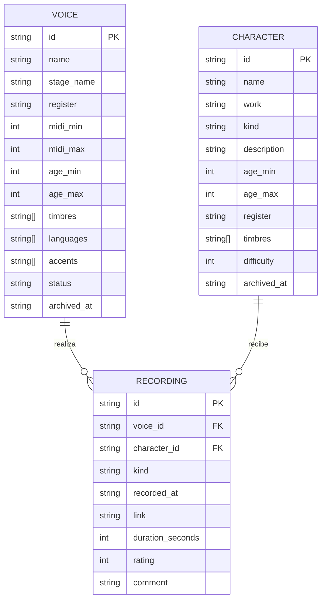

# Hokori Dub — Catálogo de personajes y voces

Especificación funcional del sistema y punto de entrada de su documentación SDD.

> **Estado:** MVP implementado y verificado. La especificación detallada vive en
> [`specs/001-catalogo-voces-mvp/`](specs/001-catalogo-voces-mvp/spec.md) y el
> código en el paquete [`hokoridub`](hokoridub/).

## 1. Objetivo

Hokori Dub es una academia de doblaje y actuación de voz. Hoy su información vive
en hojas de cálculo y mensajes sueltos: qué voces estudian o egresaron, qué
personajes están en producción y qué pruebas ha hecho cada persona. El resultado
es que el director de casting no puede responder con rapidez preguntas como
«¿quién puede interpretar a este personaje?» o «¿qué pruebas respaldan a esta
voz?».

El sistema centraliza ese conocimiento en un **catálogo local de voces,
personajes y pruebas**, con dos capacidades que lo diferencian de una lista:

1. **Trazabilidad del portafolio:** cada prueba queda vinculada a una voz y a un
   personaje, con fecha, tipo, duración, valoración y enlace al audio.
2. **Compatibilidad explicable:** el sistema calcula una afinidad de 0 a 100
   entre cada voz activa y un personaje, a partir de edad aparente, registro y
   timbre, y presenta el ranking con su nivel (alta, media, baja).

El MVP se entrega como una **CLI en Python con persistencia en un único archivo
JSON**, pensada para una persona coordinadora que trabaja en su equipo sin
infraestructura adicional.

## 2. Alcance

### Incluido

- Gestión del **perfil vocal** de cada voz: nombre, nombre artístico, contacto,
  registro, extensión vocal, timbres, edad aparente, idiomas, acentos, estado y
  notas.
- Gestión de **personajes**: nombre, obra, tipo de producción, descripción y
  requisitos vocales (edad, registro opcional, timbres, dificultad).
- Registro y edición de **pruebas** de una voz sobre un personaje, con enlace al
  audio y valoración.
- **Consulta** del catálogo de voces y personajes con búsqueda por texto, filtros
  y ordenamientos; detalle de una voz con su portafolio y de un personaje con su
  conteo de pruebas.
- **Ranking de voces compatibles** con un personaje, con afinidad numérica,
  nivel y filtro de afinidad mínima.
- **Archivado lógico** de voces y personajes, con confirmación explícita y
  conservación del histórico de pruebas.
- **Persistencia JSON versionada** con escritura atómica y carga tolerante a un
  archivo inexistente.

### No incluido

- Autenticación, roles, multiusuario concurrente o servidor web.
- Gestión de archivos de audio: solo se guardan enlaces (`http`/`https`).
- Reproducción, análisis o procesamiento de audio.
- Calendario de castings, contratos, pagos o facturación.
- Notificaciones por correo, mensajería o integraciones externas.
- Importación/exportación de hojas de cálculo o de otros formatos.
- Búsquedas fonéticas o similitud difusa; la búsqueda es por subcadena
  normalizada.
- Aplicación móvil o de escritorio con interfaz gráfica.
- Sincronización entre dispositivos o respaldo automático en la nube.

## 3. Actores

| Actor | Tipo | Responsabilidad |
| --- | --- | --- |
| **Coordinador de la academia** | Usuario único del sistema | Mantiene voces, personajes y pruebas; consulta el catálogo y el ranking de compatibilidad. Es la única persona que opera la CLI. |
| **Actor de voz / estudiante** | Objeto del catálogo | Persona cuyo perfil vocal, estado y portafolio se registran. No inicia sesión ni opera el sistema. |
| **Director de casting** | Consumidor de la información | Usa los resultados de consulta y compatibilidad para decidir a quién llamar a audición. Recibe la información del coordinador o consulta la CLI con permiso de lectura. |

## 4. Requisitos funcionales

Prioridad: **M** = must (MVP), **S** = should (MVP si el coste es bajo).

| ID | Requisito | Prioridad |
| --- | --- | --- |
| **RF-01** | El sistema debe permitir dar de alta una voz con nombre obligatorio, perfil vocal y al menos un idioma. | M |
| **RF-02** | El sistema debe validar el perfil vocal: registro del catálogo, extensión MIDI entre C2 y C7 con mínima ≤ máxima, hasta 3 timbres del catálogo, edad aparente entre 5 y 90 años y hasta 5 idiomas y 5 acentos sin duplicados. | M |
| **RF-03** | El sistema debe permitir editar los datos y el perfil de una voz activa, actualizando su fecha de modificación. | M |
| **RF-04** | El sistema debe permitir dar de alta un personaje con nombre, obra, tipo de producción, descripción y requisitos vocales. | M |
| **RF-05** | El sistema debe validar los requisitos del personaje: edad entre 5 y 90 años con mínima ≤ máxima, registro opcional del catálogo, hasta 3 timbres y dificultad entre 1 y 5. | M |
| **RF-06** | El sistema debe permitir editar los datos y requisitos de un personaje activo, incluyendo la posibilidad de dejarlo sin registro requerido. | M |
| **RF-07** | El sistema debe permitir registrar una prueba de una voz sobre un personaje, con tipo (`demo`, `audicion`, `practica`), fecha, enlace opcional, duración, valoración y comentario. | M |
| **RF-08** | El sistema debe validar los datos de una prueba: enlace `http`/`https` de hasta 500 caracteres, duración entre 1 y 3600 segundos, valoración entera entre 1 y 5 y comentario de hasta 500 caracteres. | M |
| **RF-09** | El sistema debe permitir editar una prueba existente conservando su identificador y su fecha de creación. | M |
| **RF-10** | El sistema debe mostrar el portafolio de una voz: sus pruebas de la más reciente a la más antigua, con el personaje asociado. | M |
| **RF-11** | El sistema debe listar las voces y los personajes activos en tablas legibles e indicar cuando no hay registros o cuando ningún registro coincide con el filtro. | M |
| **RF-12** | El sistema debe buscar por subcadena sin distinguir mayúsculas, tildes ni la letra ñ, en los campos descriptivos de voces y personajes. | M |
| **RF-13** | El sistema debe filtrar voces por registro, timbre, estado e idioma, y personajes por tipo y registro requerido. | M |
| **RF-14** | El sistema debe ordenar voces por nombre, edad mínima o última actividad, y personajes por nombre, actividad o dificultad. | M |
| **RF-15** | El sistema debe mostrar el detalle de una voz (perfil, datos de contacto y portafolio) y de un personaje (descripción, requisitos y cantidad de pruebas). | M |
| **RF-16** | El sistema debe calcular una afinidad entera de 0 a 100 entre una voz y un personaje según edad aparente, registro y timbre, y clasificarla como alta, media o baja. | M |
| **RF-17** | El sistema debe mostrar el ranking de voces activas compatibles con un personaje activo, ordenado por afinidad descendente, con límite opcional y afinidad mínima opcional. | M |
| **RF-18** | El sistema debe archivar voces y personajes solo con confirmación explícita, ocultarlos de las consultas y del ranking, impedir nuevas pruebas sobre ellos y conservar las pruebas históricas. | M |
| **RF-19** | El sistema debe persistir el catálogo completo en un archivo JSON versionado mediante escritura atómica, sin pérdida de datos ante fallos de escritura. | M |
| **RF-20** | El sistema debe cargar el catálogo desde JSON y tratar un archivo inexistente como catálogo vacío; ante un archivo ilegible, inválido o con referencias rotas debe informar el error y no sobrescribirlo. | M |

## 5. Requisitos no funcionales

| ID | Requisito |
| --- | --- |
| **RNF-01** | La interfaz y todos los mensajes de usuario deben estar en español; los textos deben centralizarse para evitar duplicación y deriva. |
| **RNF-02** | El tiempo de ejecución debe usar solo la biblioteca estándar de Python 3.11 o superior; `pytest` es la única dependencia de desarrollo. |
| **RNF-03** | El sistema debe funcionar de forma local y sin conexión de red; no debe enviar datos a servicios externos. |
| **RNF-04** | El comportamiento debe ser determinista: relojes e identificadores se inyectan en la lógica y los ordenamientos tienen desempates estables. |
| **RNF-05** | La escritura del catálogo debe ser atómica y no debe dejar archivos temporales ni un JSON parcial ante un error. |
| **RNF-06** | El sistema debe funcionar en Windows, Linux y macOS, con rutas y codificación UTF-8 gestionadas por la biblioteca estándar. |

## 6. Entidades principales



- **Voz:** persona del catálogo. Contiene un **perfil vocal** (registro, extensión,
  timbres, edad aparente, acentos), idiomas, datos de contacto, estado
  (`activa`, `en_pausa`, `egresada`) y sus pruebas.
- **Personaje:** rol de una producción. Contiene la descripción y los
  **requisitos vocales** que debe cumplir quien lo interprete.
- **Prueba:** evidencia de que una voz trabajó sobre un personaje. Es la unidad
  del portafolio y la base de la última actividad.
- **Catálogo:** agregado raíz con todas las voces, personajes y pruebas. Es la
  unidad que se carga y se guarda.

## 7. Reglas de negocio

| ID | Regla |
| --- | --- |
| **RN-01** | El nombre de una voz o de un personaje es obligatorio; los demás textos tienen longitudes máximas y se recortan los espacios sobrantes. |
| **RN-02** | Archivar es un borrado lógico: el registro deja de aparecer en consultas y rankings, pero se conserva con su historial de pruebas. |
| **RN-03** | No se puede registrar una prueba sobre una voz o un personaje archivado, ni editar registros archivados. |
| **RN-04** | La valoración de una prueba es un entero de 1 a 5; la duración, si se informa, es un entero de 1 a 3600 segundos. |
| **RN-05** | La afinidad se calcula como `40 × solapamiento de edades + 30 × coincidencia de registro + 30 × cobertura de timbres`, truncada a entero y acotada a 0–100. Sin registro exigido o sin timbres exigidos, esa parte puntúa completo. |
| **RN-06** | Los identificadores de voces, personajes y pruebas son únicos en todo el catálogo; un identificador duplicado es un error de validación. |

### Detalle de la afinidad (RN-05)

- **Edad (40 puntos):** proporción entre la intersección de los rangos de edad de
  la voz y del personaje y la unión de ambos rangos. Si no hay intersección,
  aporta 0.
- **Registro (30 puntos):** 30 si el personaje no exige registro o si coincide con
  el de la voz; 0 en caso contrario.
- **Timbre (30 puntos):** proporción de timbres exigidos por el personaje que la
  voz posee. Si el personaje no exige timbres, aporta 30.
- **Niveles:** `alta` desde 80, `media` desde 50, `baja` por debajo de 50.

## 8. Puesta en marcha

Requisitos: Python 3.11 o superior. Para ejecutar las pruebas, `pytest` 8.

```powershell
python -m pip install -r requirements-dev.txt
python -m hokoridub --datos data/catalogo.json voz listar
python -m pytest
```

También puede instalarse como comando:

```powershell
python -m pip install -e .
hokoridub --datos data/catalogo.json personaje listar
```

Ruta de datos, en orden de prioridad: opción global `--datos`, variable de
entorno `HOKORIDUB_ARCHIVO`, archivo `catalogo.json` del directorio actual.
La opción global debe escribirse **antes** del subcomando.

Ejemplos de uso:

```powershell
# Alta de una voz
python -m hokoridub voz agregar --nombre "Valeria López" --registro mezzosoprano --extension G3-G5 --edad 18-32 --idiomas es,en --timbres dulce,calido

# Alta de un personaje
python -m hokoridub personaje agregar --nombre "Maya" --obra "Guardianes del Bosque" --tipo animacion --descripcion "Niña curiosa de 10 años" --edad 8-14 --timbres dulce,infantil --dificultad 4

# Registrar una prueba y consultar el ranking
python -m hokoridub prueba agregar --voz ID_VOZ --personaje ID_PERSONAJE --tipo demo --duracion 42 --valoracion 5
python -m hokoridub compatibles ID_PERSONAJE --min-afinidad 50 --limite 5
```

Códigos de salida: `0` éxito, `2` error de validación, dato no encontrado o
confirmación faltante, `1` error de almacenamiento.

## 9. Documentación SDD

| Documento | Contenido |
| --- | --- |
| [`docs/constitution.md`](docs/constitution.md) | Principios innegociables y su verificación. |
| [`specs/001-catalogo-voces-mvp/spec.md`](specs/001-catalogo-voces-mvp/spec.md) | Especificación detallada, historias de usuario, criterios de aceptación y casos límite. |
| [`specs/001-catalogo-voces-mvp/plan.md`](specs/001-catalogo-voces-mvp/plan.md) | Diseño técnico, modelo de datos, algoritmos, decisiones y trazabilidad. |
| [`specs/001-catalogo-voces-mvp/tasks.md`](specs/001-catalogo-voces-mvp/tasks.md) | Desglose de tareas con criterio de terminado. |

## 10. Decisiones asumidas y preguntas abiertas

Durante la especificación quedaron tres preguntas de dominio. Para no bloquear el
MVP se tomaron estas decisiones, documentadas para validación con la academia:

| Pregunta | Decisión asumida |
| --- | --- |
| ¿Cómo se pondera la compatibilidad? | Fórmula 40/30/30 de RN-05, con niveles alta/media/baja. |
| ¿Qué registros vocales existen? | Seis registros clásicos: soprano, mezzosoprano, contralto, tenor, barítono y bajo. |
| ¿En qué idioma se escribe la documentación y la interfaz? | Documentación, interfaz y mensajes en español; código e identificadores en inglés. |

Preguntas que siguen abiertas para una próxima iteración:

- ¿Se necesitan varios usuarios con permisos diferenciados (coordinación vs.
  dirección de casting)?
- ¿Debe el sistema conservar versiones anteriores de una prueba o solo la última?
- ¿Se requiere adjuntar archivos de audio en lugar de solo enlaces?
- ¿La afinidad debe incorporar otros criterios (idioma, acentos, altura de la voz
  frente a la extensión del personaje)?
